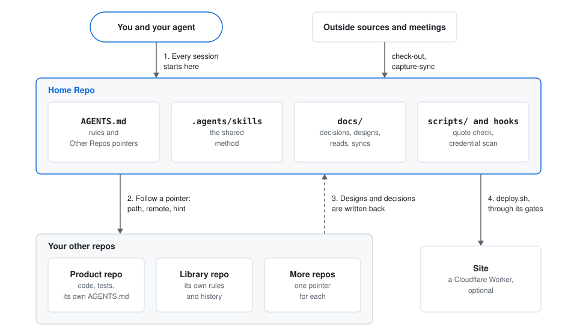

# home-repo-template

A template for a Home Repo: one repository where every agent session starts. It holds the rules, the shared skills, a
dated document corpus and the pointers to your other repos.

## What a Home Repo is

A project often spans several repositories: a product, a library, a website, a set of documents. An agent that starts
in one of them sees only that one. Each repository then gets its own copy of the rules and the skills, the copies
drift apart, and a decision that crosses two repositories has no place to live.

A Home Repo is the one repository that you start in. It holds what is true across the whole project:

- **The rules.** One `CLAUDE.md` that every session loads: how to work, when to stop and ask, which words to use.
- **The pointers.** One line for each other repository: its name, what it is, its local path, its remote, and a hint
  such as "read its `CLAUDE.md` before you change it".
- **The shared skills.** The method of the project, kept under version control and the same for every person.
- **The record.** Designs, decisions, plans, meeting notes and reads of outside sources, as dated Markdown files.

Each other repository keeps what is true of that repository alone: its code, its build and test commands, its own
`CLAUDE.md`, its own skills, its issues and its history. Nothing moves out of it except the copies of shared material.

It is not a monorepo. The code stays where it is. Use a Home Repo when one repository for everything is not possible,
for example when some repositories are public and some are private.

## How it works

<picture>
  <source media="(prefers-color-scheme: dark)" srcset="docs/diagrams/home-repo-dark.svg">
  
</picture>

1. **Start in the Home Repo.** The agent loads `CLAUDE.md`, and with it the rules and the list of other repositories.
2. **Follow a pointer.** When the work needs another repository, the agent opens it at the path the pointer gives, or
   clones it from the remote. It reads that repository's own `CLAUDE.md`, and it works in a worktree, one for each
   feature, so that several agents can work in one repository at the same time.
3. **Write the record back.** A design, a plan or a decision about any repository is a dated file under `docs/` here.
   Code in another repository is cited at a pinned revision. An issue is filed in the repository whose code it changes.
4. **Publish, if you want a site.** `scripts/deploy.sh` builds the corpus into a small site and deploys it through a
   set of gates. This step is optional.

This template also carries a working method for the record: every outside source is archived, every quote is checked
against the archive, and every meeting becomes a record with its decisions and its todos.

## What is in it

| Path | What it is |
|---|---|
| `CLAUDE.md` | The rules, and the "Other Repos" pointers. Claude Code loads it at the start of a session |
| `AGENTS.md` | One line that points other harnesses at `CLAUDE.md` |
| `CONTEXT.md` | The glossary: one fixed term per entry, with the words to avoid |
| `docs/` | The corpus, one folder per question (`docs/README.md`), with a worked example of a read |
| `reports/` | Self-contained HTML pages for readers who do not open the repo |
| `.claude/skills/setup-repo` | Make a fresh copy your own: the repo's purpose, the pointers, the glossary, the site and the deploy settings, in rounds of questions |
| `.claude/skills/check-out` | Read an outside source into an archive, a read doc and a table of borrows |
| `.claude/skills/capture-sync` | Turn a meeting or a chat into a record with rulings, proposals and todos |
| `.claude/skills/share-report` | Build a page from a doc and check it by eye |
| `scripts/check_quotes.py` | Checks each quote in a doc as a fixed string against its archive. `scripts/quote-reads.json` lists every read |
| `scripts/credscan.py` | A scan for credential patterns over the files you are about to commit or publish |
| `.claude/skills/browser-harness` | A copy of the browser-harness skill (MIT, Browser Use): how the agent controls a real browser. The command itself is installed separately |
| `scripts/update-skills.py` | Refreshes each copied skill from its upstream repo at one commit, and reports when a copy is behind. It never commits |
| `.claude/skills/deploy-site` | Deploy the site to Cloudflare Pages through its gates. `RULES.md` holds the one-time setup and the rule behind each gate |
| `scripts/deploy.sh` | The deploy chain: a dist pinned to HEAD, the gates, the upload, and the Access check on the new deployment. A dry run unless given `--deploy` |
| `scripts/build-hub.py` | The hub generator. It writes `index.html` (counts, start here, what's new), `docs.html` (every doc and report, with type and age filters, a sort and full-text search), `changelog.html` (one row per deploy) and `search-index.json` |
| `site/manifest.json` | Optional curation for the hub: the site's title, the "Start here" list, and a one-line note for a doc. A doc with no entry still appears |
| `hub.css`, `hub.js`, `md.html` | The hub's stylesheet and script, written by hand, and a Markdown viewer. To look at the site before a deploy, serve the repo root: `python3 -m http.server --bind 127.0.0.1` |
| `site/_headers`, `site/_redirects` | Pages headers (archived captures are served inert) and redirects |
| `docs/diagrams/`, `scripts/build-readme-diagram.py` | The diagram above, as a light and a dark SVG, and the script that writes both |
| `DEPLOY-LEDGER.md` | One entry per deploy. The script reads the top entry as its baseline |
| `.claude/hooks/refuse-bare-wrangler.py` | A `PreToolUse` hook that refuses a bare `wrangler pages deploy`, with its test. `.claude/settings.json` wires it |

## Set it up

1. Copy this folder beside your other repos (on GitHub: "Use this template"), and clone it.
2. Run the checks. All five must pass:

   ```bash
   python3 -I scripts/check_quotes.py --all            # the worked example: 1 of 1 reads pass
   python3 -I scripts/check_quotes.py --all --plant    # must exit 1
   python3 -I scripts/credscan.py --controls           # controls 15/15
   python3 -I .claude/hooks/test_refuse_bare_wrangler.py
   python3 -I scripts/build-hub.py --check             # the four generated hub files are current
   ```

3. Start your agent in this folder and say "set up this repo". The `setup-repo` skill asks for what only you can
   decide and does the rest: what the repo is, the pointers to your other repos, the glossary, the site's title, the
   deploy settings, and whether to keep the worked example. It changes nothing outside this folder.
4. Ask the agent to check out a URL. The `check-out` skill runs the chain.
5. To publish the site: do the one-time Cloudflare setup in `.claude/skills/deploy-site/RULES.md`, then say "deploy".
   The first upload needs `npx`, `rsync` and a Cloudflare login.

The checks need Python 3.9 or later and nothing else. A scan of the whole repo reports hits in `scripts/credscan.py`
itself: they are its own control samples. Scan the files you add, not the scanner.

## Status of the deploy script

The dry run and every gate before the upload have been run. The upload, the check for a newer deployment and the
`302` check have run only against stand-ins for `wrangler` and `curl`, not against Cloudflare. Two things are not
measured on a live site: the `/md` rule in `site/_headers`, and the Access steps in
`.claude/skills/deploy-site/RULES.md`. Check both on your first deploy.

## Installed skills, not copied

Five skills in this repo are specific to its method. They call general skills that you install for your user
and that stay installed. With `npx skills add <source>`:

| Skill | Source | Used for |
|---|---|---|
| `archify` | `tt-a1i/archify` | Architecture, flow and sequence diagrams for `share-report` |
| `architecture-diagram` | `cocoon-ai/architecture-diagram-generator` | Dark-themed system diagrams |
| `ppt-master` | `hugohe3/ppt-master` | Slide decks as SVG projects, exported to `.pptx` |

Check each source's licence before you copy a skill into a repo that you share.

One skill from outside is copied in, because two of this repo's skills depend on it: `browser-harness`
(`.claude/skills/browser-harness/`, MIT, from [browser-use/browser-harness](https://github.com/browser-use/browser-harness)
at one commit, which `SOURCE.md` there records). The skill tells the agent how to drive your own Chrome over CDP. It
does not install the `browser-harness` command: install that once for your user, following `references/install.md` in
that folder. `check-out` uses it for sources that render in the client, and `share-report` for the visual check.

To update a copied skill:

```bash
python3 -I scripts/update-skills.py --check   # is the copy behind upstream?
python3 -I scripts/update-skills.py           # fetch the newest upstream commit and rewrite the copy
git diff .claude/skills/                      # read it: a skill is instructions that the agent follows
```

The script never commits, so an upstream change reaches your agent only after you have read it. To copy in another
skill the same way, add one entry to `VENDORED` at the top of the script.

## Left out on purpose

- **Search at a large scale.** The hub's search loads the text of every doc as one file. That is fine for some
  hundreds of docs. Past that, replace `search-index.json` with a real search index.
- **A second site.** A public room for outside readers needs its own Pages project, its own deploy script and a build
  step that resolves every `[FILL]` marker.
- **A deck pipeline** and **an issue board.** Add them when you need them.

## Licence

MIT. See `LICENSE`. The copied skill under `.claude/skills/browser-harness/` keeps its own MIT licence and copyright
(Browser Use), in the `LICENSE` file beside it.
